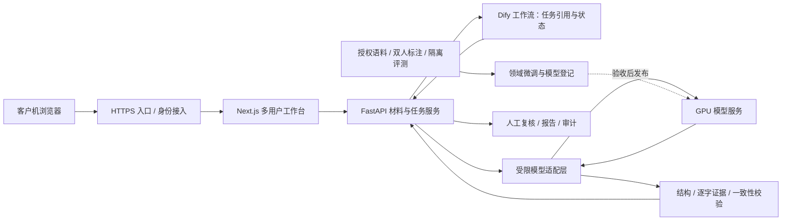

# 网暴行为溯源追踪工作台

**让每一份研判回到原始材料，让每一条观察都有证据，让每一次复核留下记录。**

面向网络暴力研究、内容治理与执法辅助的中文语言分析工作台。项目以服务器集中部署为方向：客户机通过浏览器提交原始材料，服务器组织上下文、调度工作流与模型，校验结果，再交由有权限的人员复核。建设目标是贯通**材料来源、行为观察、证据引用、人工复核与版本追踪**，形成可持续演进的研判基础设施。

“溯源追踪”目前指向已导入材料的来源记录、内容哈希、消息引用和处理记录。互联网账号实名核验、跨平台自动采集、传播图谱和完整电子证据固化属于后续建设内容。

## 项目定位与当前版本

当前发布的是可运行的工程原型，已具备多用户权限、原始材料导入、异步任务、Dify 提交编排、受限模型网关、结果校验、人工复核和报告导出。默认安装以入库与人工工作台模式运行；启用推理需要另行配置 Dify、模型及网关。

**本项目尚未完成领域微调，也没有建立独立人工金标所支持的识别准确率结论。** 模型给出语言行为观察，人工复核给出复核意见；违法认定、身份确认与司法结论由有权人员结合完整证据作出。自动化软件测试通过不能证明语言识别正确率。

| 能力 | 本次公开源码 | 正式应用建设方向 |
|---|---|---|
| 材料输入 | UTF-8 TXT / JSON / JSONL / CSV、1 MiB 输入上限、最多 100 个窗口 | 授权导出接入、批量导入服务、来源与保全体系 |
| 语言研判 | 三态判断、攻击/语境标签、逐字证据校验、缺上下文处理 | 中文领域训练、分层评测、可信的大模型服务 |
| 用户协作 | 管理员、研判员、复核员、审计员；任务归属与分配 | 单位身份平台、组织隔离、细化授权 |
| 工作流 | Dify 仅传任务引用；服务端异步执行和结果校验 | 多模型分工、分歧仲裁、策略与版本管理 |
| 证据追踪 | 原始材料哈希、消息引用、任务版本、模型响应元信息、追加复核 | 来源授权台账、签名/可信时间、外部不可篡改审计 |
| 数据持久化 | SQLite、单业务进程、有限分页、幂等与恢复 | 经迁移验证的数据库与队列、高可用及容量压测 |

## 服务器与客户机架构

正式架构采用客户机浏览器、业务服务器、工作流服务器、GPU 推理服务器和训练数据平台。业务服务器承担材料与权限管理，GPU 服务器承担模型推理；训练与在线推理使用独立资源池。



上图中的训练平台、多模型协作、vLLM 大模型适配和高可用存储是推荐生产建设方案。仓库当前包含固定 Qwen3-4B / Ollama 参考网关；它不能通过修改模型名称直接切换成 vLLM 或任意大模型。

## 快速开始

支持在 Linux 服务器安装工作台，客户端无需安装 Python、模型或 Dify。

1. 获取源码：`git clone https://github.com/zhaungshenme/cyberbullying-workbench.git workbench`。
2. 按 [服务器部署指南](docs/DEPLOYMENT.md) 安装 Python / Node / pnpm 依赖，生成私有配置，启动前后端。
3. 管理员使用首次生成的临时口令登录，修改密码，建立其他角色账号。
4. 研判员输入文本或导入 [格式样例](examples/README.md)，创建任务。
5. 配置 Dify 与模型后启用推理；默认关闭推理时，材料入库排队，页面明确显示处理状态。
6. 管理员分配任务，复核员检查原文、证据与语境，审计员按授权查看记录，导出 JSON 报告。

没有模型环境时可以先验收多用户、导入、授权和历史查询；不能把排队材料当作已完成研判。

## 使用、模型、训练与数据

| 文档 | 内容 |
|---|---|
| [部署指南](docs/DEPLOYMENT.md) | 服务器安装、私有环境、systemd、HTTPS、Dify 导入、推理启用与恢复 |
| [操作与输入输出](docs/USAGE.md) | 四种角色、输入格式、任务状态、证据引用、复核与导出 |
| [生产架构与多模型工作流](docs/ARCHITECTURE.md) | 模型分工、数据流、吞吐与正确率、故障与人工复核 |
| [模型选择与微调](docs/MODELS_AND_TRAINING.md) | 官方模型获取、算力规划、LoRA/QLoRA/SFT、评估与上线 |
| [数据集来源与治理](docs/DATASETS.md) | 作者仓库、下载途径、许可边界、标签映射、金标与分组切分 |
| [路线图](docs/ROADMAP.md) | 已实现能力、下一阶段交付项与验收标准 |
| [验证记录](docs/VALIDATION.md) | 本次发布检查、历史工程测试与未验证事项 |

后续模型选型将以独立盲测结果为依据。充足算力方案优先评估高水平、可本地部署的中文开放权重模型，使用大模型进行困难语境研判，用较小模型承担高频任务与辅助筛选；具体型号、固定版本和硬件估算见模型文档。模型文件与真实材料通过受控途径获取，不随仓库发布。

训练方案从未微调基线开始，经双人标注与仲裁形成数据，再比较领域 SFT / LoRA / QLoRA 的收益。测试集按来源、事件和时间隔离；原始数据集标签不能直接当作司法网暴金标。官方可追溯数据与授权业务语料共同建设训练体系，来源许可逐项审核。

## 源码结构

```text
backend/         材料、任务、权限、审计、结果校验与异步 worker
frontend/        Next.js 多用户工作台及服务端 API 代理
dify/            任务提交 DSL，导出不包含密钥
model_gateway/   固定 Qwen3-4B / Ollama TLS 参考网关
deploy/          私有环境示例、systemd 与 HTTPS 入口参考配置
scripts/         生成私有配置、渲染可移植工作流
training/        训练配置模板与样例约定
examples/        明确标记的合成输入样例
docs/            部署、使用、架构、模型、数据与迭代计划
```

## 持续更新

项目后续将持续更新，重点推进高算力模型适配、多模型工作流、授权数据治理、领域微调、溯源追踪与生产可靠性。每个阶段公布源码、版本变更、验证方式与能力边界；训练成果以模型与数据版本、独立评测及误判分析为依据。欢迎通过 Issues 提交使用反馈、部署问题与改进建议，真实案件原文和个人信息请通过受控渠道处理。

## 来源与许可

前端参考 Dify 官方 `langgenius/webapp-text-generator` 固定版本，保留其 [MIT 许可证](frontend/LICENSE)。详见 [SOURCE.md](SOURCE.md) 与 [第三方声明](THIRD_PARTY_NOTICES.md)。数据集、模型及 Dify 服务分别遵守其来源许可；本次发布未为其提供新的使用授权。除已明确许可的文件外，本仓库其余自有代码尚未指定统一开源许可证。
